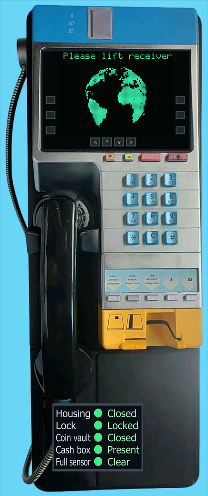
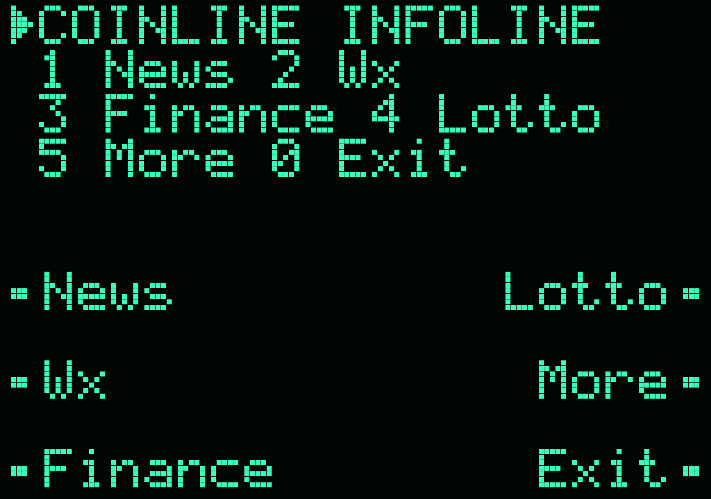
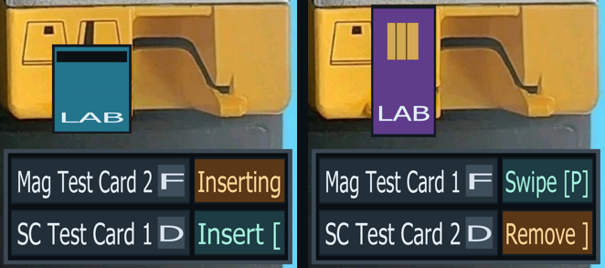
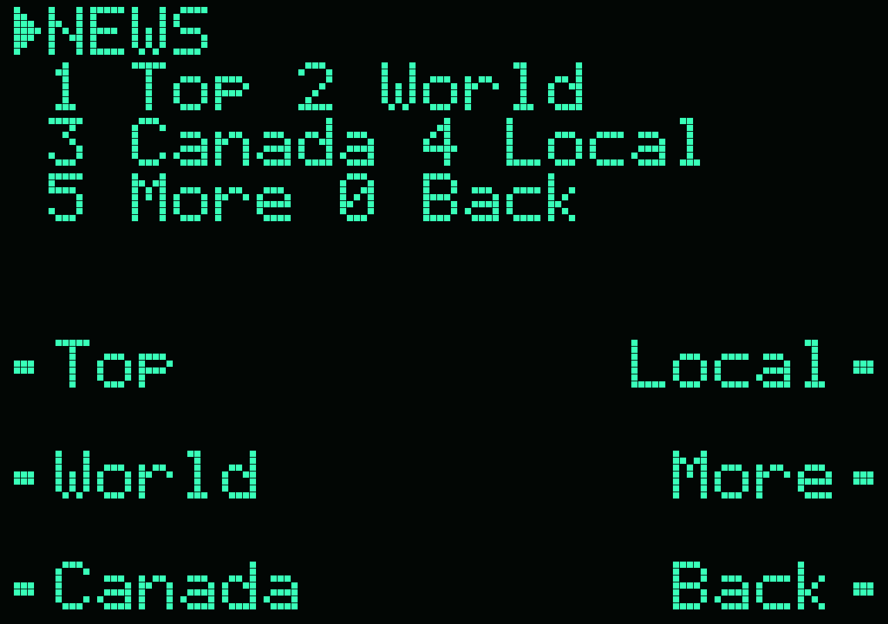
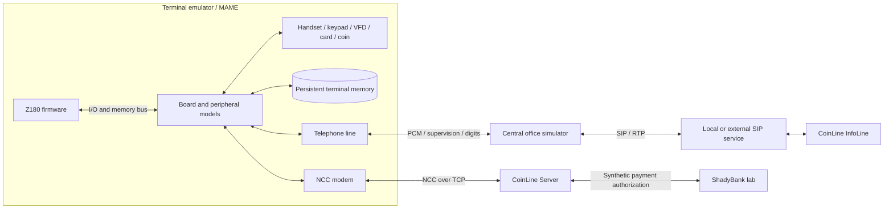

# CoinLine Terminal Emulator

  

**A Millennium payphone, running inside your computer.**

Lift the handset. Hear the dial tone. Drop a virtual quarter into the coin slot. Swipe a synthetic card. Dial a number, connect to a SIP call, or browse an interactive information service on a glowing eleven-line vacuum fluorescent display.

This is not a payphone-themed softphone. CoinLine emulates the Z180 control processor, the telephony controller, peripheral buses and telephone-line hardware in MAME. The terminal firmware installs itself, checks its hardware, downloads configuration tables, writes persistent memory, selects voice prompts and decides how to handle a call.

<table>
<tr>
<td width="34%" valign="top">

</td>
<td valign="top">
<h3>A real terminal experience</h3>

Two-line and graphical terminal profiles, an interactive handset and front panel, real keypad and softkey inputs, a working coin escrow, card readers, enclosure switches and firmware-driven audio.

<h3>Information services over a phone call</h3>

This menu was received over a real SIP/RTP media session. The emulated terminal detected the alert signal, decoded Bell 202 FSK data, acknowledged the message and rendered the screen.

Actual emulator screenshots, not UI designs or generated illustrations.
</td>
</tr>
</table>

The goal is to preserve and explore the whole telephone system, not just its handset. A terminal, central office, management server and information service can now be brought up together on ordinary computers, without a physical payphone on the bench.

## Get it running

Native packages are built for **Windows x64, Linux x64 and macOS Apple Silicon**. Download from [Releases](https://github.com/andrew867/CoinLine-emu/releases) or the latest successful [native build artifacts](https://github.com/andrew867/CoinLine-emu/actions/workflows/native-release.yml).

1. Extract the package into a writable directory. Supply your authorized terminal and Voiceware images using the [ROM input layout](BUILDING.md#include-your-local-rom-inputs). Public packages do not include these images.
2. Start the appropriate terminal. The two profiles keep separate configuration and persistent storage.
3. For a fresh terminal, run its normal INSTALL procedure with [CoinLine Server](https://github.com/andrew867/CoinLine) available. The terminal downloads its own tables and writes its own battery-backed state.

| Platform | Two-line terminal | Graphical terminal |
|---|---|---|
| Windows | `Start OEM.cmd` | `Start Graphical.cmd` |
| Linux/macOS | `./start-oem.sh` | `./start-graphical.sh` |

On Linux/macOS, the included Quick Start lists the system libraries. Run `./setup-sip.sh` once if you want SIP or local InfoLine service routes. Configure the carrier account in the corresponding INI and start with `--sip`. The simulated central office is available without a carrier account.

The virtual card wallet works in both profiles. Click a card's name to cycle through your synthetic test fixtures, press `P` to swipe a magnetic card, or use `[` and `]` to insert and remove a contact card. The reader artwork moves with the actual emulated card sensors.

**[Full quick start, controls and INSTALL →](RUNNING.md)** · **[Build from source →](BUILDING.md)**

## What makes it different

- **Firmware-driven installation.** Tested terminals start with erased EEPROM and blank SRAM, perform their physical installation checks, connect to NCC, receive tables and return to service on a separate restart. No preinstalled table-state shortcut is required.
- **Emulated hardware, not scripted menus.** Earlier and later control-board profiles model memory mapping, interrupts, DMA, serial peripherals, display controllers, keypad, magnetic and chip-card interfaces, coin escrow, cashbox and service switches.
- **The original sound experience.** Voice prompts, dial tones, attention tones and feedback are produced through the emulated Voiceware device, including its stand-alone waveform synthesis mode. SIP calls carry real handset audio; the physical tone path also supports connected DTMF.
- **A graphical telephone terminal.** The eleven-line VFD renders downloaded bitmap advertising, supports physical softkeys and can interact with ADSI services over ordinary telephone audio. Coin Basic and Desk profiles are also represented.

 The News submenu, selected by pressing a real emulated keypad button during the same ADSI session.

## How it fits together

The projects form a private or local telephone test network. The emulator and management server communicate over the terminal's NCC transport, while the central office handles the voice path.

- [CoinLine Server](https://github.com/andrew867/CoinLine): terminal provisioning, NCC table downloads, rating and operational data.
- [CoinLine InfoLine](https://github.com/andrew867/CoinLine-ADSI): interactive ADSI information services and telephone menus.
- ShadyBank is an optional synthetic payment provider for the lab, not a production payment issuer.

## What has been verified

The [firmware acceptance catalog](docs/uat/firmware-acceptance-catalog.md) tracks **126 firmware identifiers**. In the recorded acceptance baseline, **25 of 26 runnable cases** completed cold INSTALL and an independent in-service restart.

| Area | Observed result |
|---|---|
| Installation and NCC | Earlier and later firmware, required table acknowledgments, persistent state and separate warm boot |
| Graphical VFD | Native pixels, softkey input, and 16 exact downloaded advertisement bitmap matches |
| Telephone audio | SIP calls, line supervision, native Voiceware synthesis, real connected DTMF and cross-platform loopback media |
| Coin accounting | Native quarter-rated local call, coin record, collection and empty replacement-box report |
| Magnetic and smart cards | Native reader checks, synthetic magnetic authorization trials, generic synchronous and asynchronous chip-card transport |
| ADSI | Genuine CAS/A, FSK, message acknowledgments, News selection, Back, Exit and clean teardown |
| Firmware upgrades | Persistent dual NOR flash, normal bootstrap restart and scheduled code-server call; actual remote image transfer remains open |

This is firmware-on-emulator evidence, not a physical-terminal certification. A successful prior ADSI menu test does not mean every live host timing condition is qualified. Graphical paid-call classification, long-frame PCM reliability, modern lab magnetic-card settlement and historical chip-card payment applications are tracked separately.

**[Current acceptance and remaining work →](docs/STATUS.md)**

## Explore the project

| If you want to… | Read this |
|---|---|
| Run a terminal | [Quick start and operating guide](RUNNING.md) |
| Build or package it | [Build instructions](BUILDING.md) |
| Understand the machine | [Architecture](docs/architecture.md) and [board profiles](docs/board-profiles.md) |
| Dig into the chip and bus models | [Hardware and device documentation](docs/README.md#hardware-reference) |
| Reproduce acceptance tests | [Testing](TESTING.md) and [automated firmware runner](tools/acceptance/README.md) |
| See exact test evidence | [Project status](docs/STATUS.md) |

## License

The emulator is GPL-2.0-or-later; its MAME components carry their applicable licenses. The separately licensed CoinLine server communicates with the emulator across a process and protocol boundary. Public packages contain the emulator and its original telephony-controller model; authorized program and voice images are supplied locally by the operator. See [LICENSE](LICENSE) and [license strategy](LICENSE-STRATEGY.md).
